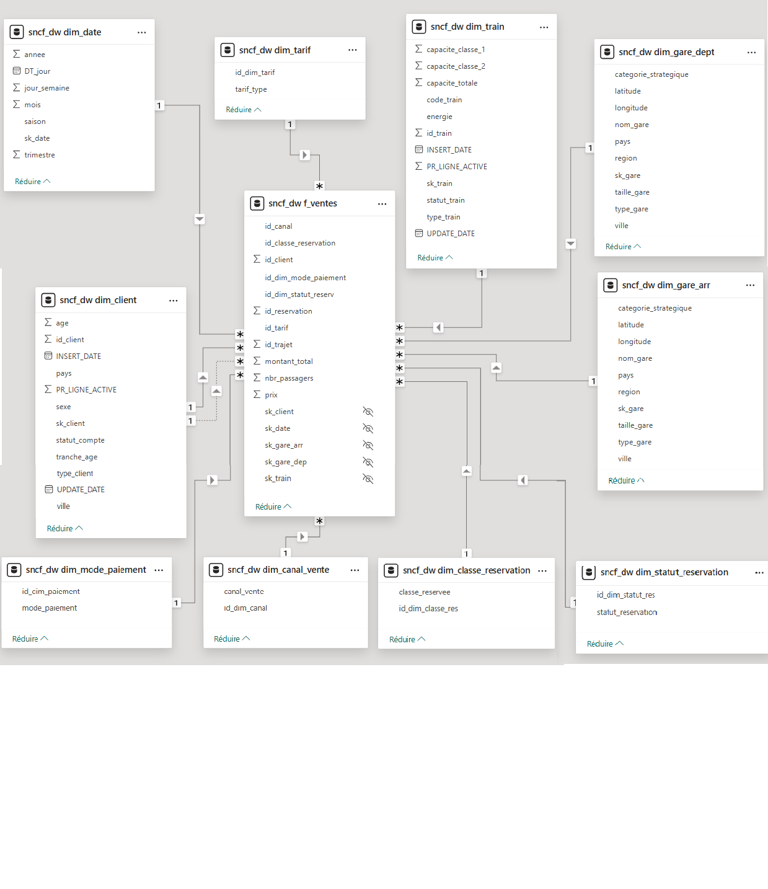
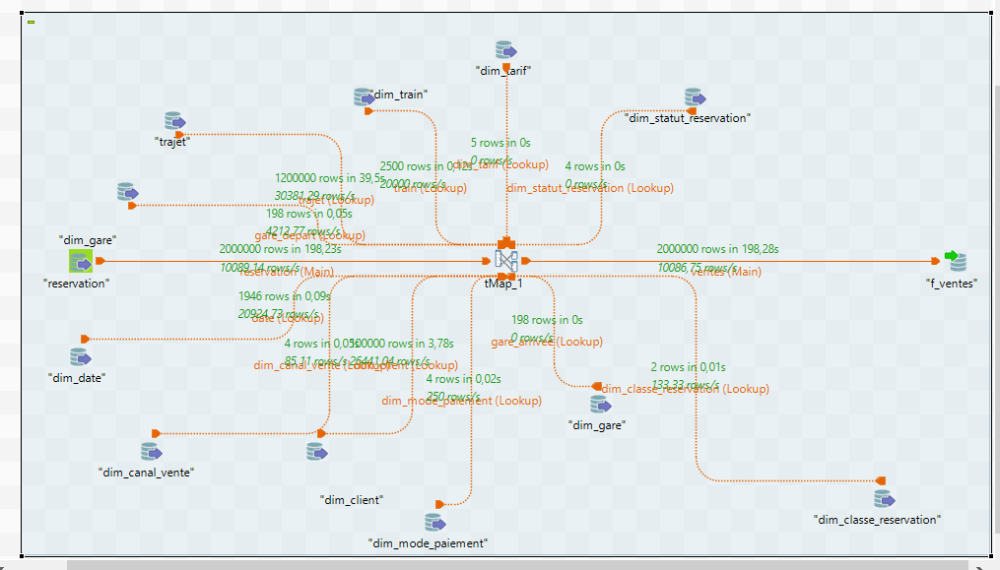
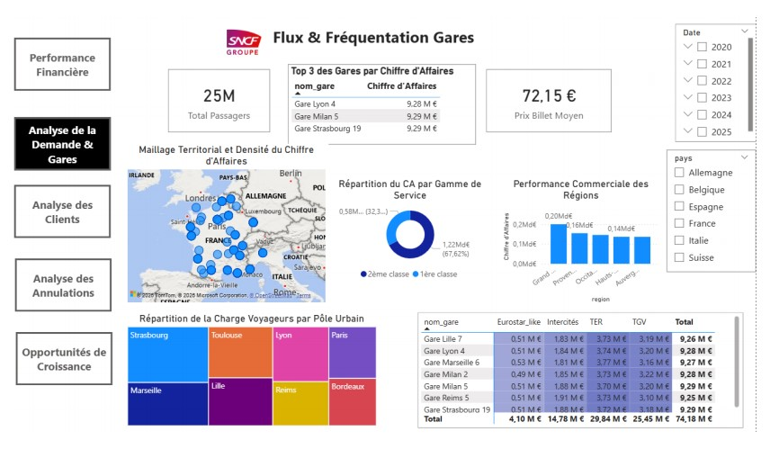

# 🚆 Pilotage des Flux Data SNCF : Intégration Talend et Reporting Avancé sous Power BI
---

## 📌 Contexte et Problématique du Projet
Le secteur du transport ferroviaire génère quotidiennement des masses colossales de données transactionnelles. Pour une entreprise comme la SNCF, la capacité à transformer ces données brutes en informations décisionnelles est un levier stratégique majeur. 

Ce projet implémente une **chaîne décisionnelle de bout en bout** permettant de surmonter les verrous traditionnels (cloisonnement des données, limites des performances OLTP, et nettoyage des données hétérogènes) en structurant plus de **10 millions de lignes de réservations** et **6 millions de lignes de trajets**.

---

## 🏗️ Architecture Technique & Chaîne Décisionnelle
L'architecture repose sur une approche hybride combinant l'Open Source pour l'intégration et l'écosystème Microsoft pour l'analyse multidimensionnelle :
1. **Extraction, Nettoyage & Chargement (ETL) :** Utilisation de **Talend Open Studio** pour automatiser l'ingestion des fichiers CSV, harmoniser les formats (gestion des dates et normalisation des genres *M/H* en *HOMME/FEMME*) et charger la Base de Données Opérationnelle (DBO).
2. **Entrepôt de Données (Data Warehouse) :** Modélisation en **Schéma en Étoile** sous MySQL, intégrant des dimensions optimisées, des *Junk Dimensions* (modes de paiement, canaux de vente) et des *Role-Playing Dimensions* (gares de départ et d'arrivée).
3. **Analyse Multidimensionnelle (OLAP) :** Migration des données vers **SQL Server** et construction d'un Cube OLAP via **SSAS (SQL Server Analysis Services)** et Visual Studio pour exploiter la puissance d'analyse du langage **MDX**.
4. **Restitution & Business Intelligence :** Connexion directe au Data Warehouse et développement de dashboards interactifs sous **Power BI**, pilotés par des mesures en langage **DAX**.

---

## 📊 Aperçu Visuel du Projet

### Modélisation du Data Warehouse (Schéma en Étoile)


### Flux d'intégration ETL (Talend)


### Tableau de Bord Power BI 


---

## 📈 Indicateurs Clés & Résultats Métier (Power BI)
Le rapport Power BI développé s'articule autour de 5 axes analytiques majeurs :
* **Performance Financière :** Pilotage d'un Chiffre d'Affaires global de **1,80 Md€** généré par **25 millions de passagers** et **10 millions de réservations**.
* **Analyse de la Demande & Gares :** Identification des hubs stratégiques (Gare Lyon 4, Marseille 6, Strasbourg 19) et analyse de la répartition par gamme de service (la 2ème classe représente près de 67,6% des revenus).
* **Segmentation Clients :** Analyse comportementale mettant en avant l'âge moyen des voyageurs (46 ans) et une forte concentration des clients dans les catégories "Jeunes Actifs" et "Seniors Actifs".
* **Suivi des Annulations :** Quantification des pertes sèches (taux d'annulation global de **7,01%** représentant **126,27 M€** de CA perdu) et réconciliation financière du Brut au Net.
* **Leviers de Croissance :** Matrice de segmentation croisant la fréquence d'achat et le panier moyen pour optimiser les politiques tarifaires et de fidélisation.

---

## 📂 Structure du Dépôt
```text
Decision-Support-System-SNCF/
├── assets/                    # Captures d'écran (modèle, Talend, Power BI)
│   ├── bi_analyses.png
│   ├── data_model.png
│   └── etl_talend.png
├── docs/                      # Rapport académique complet du projet
│   └── Rapport_Projet_SNCF.pdf
└── README.md                  # Documentation technique du projet